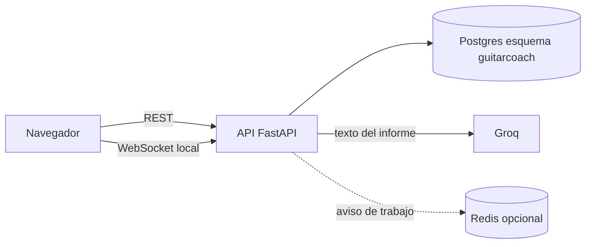
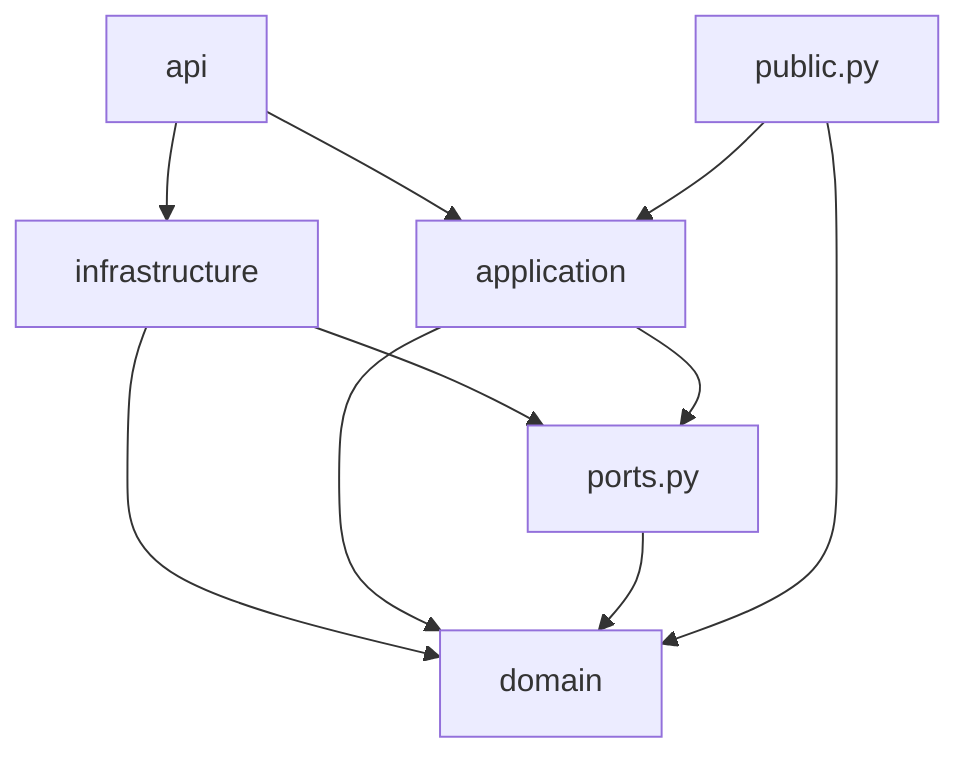
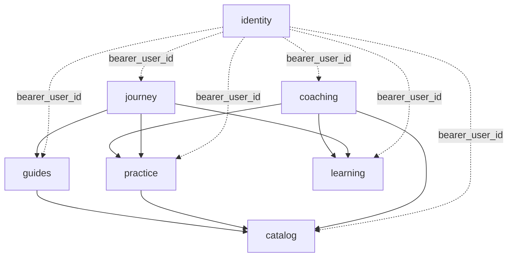
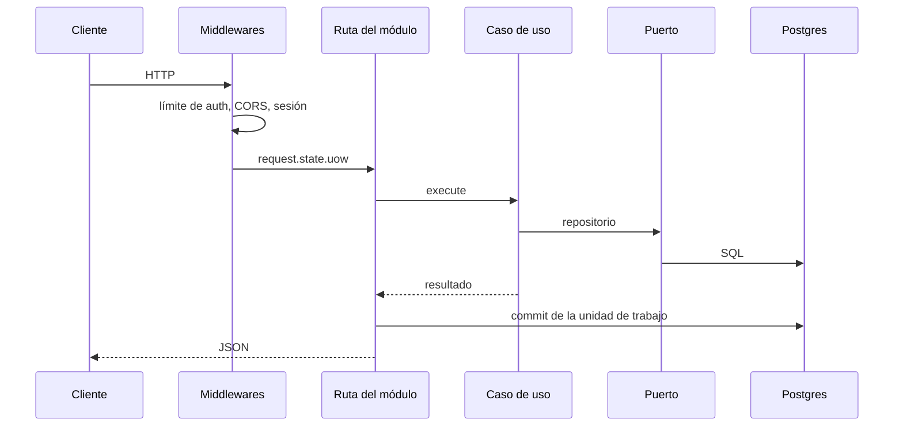

# Arquitectura de software

GuitarCoach API es un **monolito modular**. Un solo proceso de FastAPI y una sola base PostgreSQL atienden todas las capacidades. El código está partido por negocio, no por capas técnicas globales: cada módulo tiene su dominio, sus casos de uso y su persistencia, y solo enseña a los demás una fachada pequeña.

El audio del alumno no entra aquí. El navegador escucha, juzga y manda telemetría. Este servicio guarda cuentas, canciones, intentos, informes y guías, y pide texto al tutor cuando hace falta.

## Por qué este estilo

Un microservicio por capacidad obligaría a desplegar, versionar y transaccionar varios procesos para un equipo y un curso. Un solo archivo de rutas mezclaría identidad, scraping e informes y haría imposible mover una capacidad sin arrastrar las otras.

El monolito modular conserva una transacción y un despliegue, y deja cada capacidad aislada. Sacarla a otro proceso más adelante significa llevarse su carpeta y sustituir su `ports.py` por una llamada de red. Las reglas de esa frontera las vigila el CI, no la costumbre.

## Vista de ejecución



| Pieza | Dónde vive | Qué hace |
| --- | --- | --- |
| Interfaz | repositorio `guitarcoach-frontend` | Micrófono, partitura, pantallas. Habla con esta API por HTTP. |
| API | este repositorio, `app/` | Casos de uso y HTTP. |
| Esquema | repositorio `guitarcoach-database` | Migraciones. Este código no crea tablas. |
| Tutor | API de Groq | Redacta el informe. Si falla, el análisis local responde igual. |
| Avisos | Redis | Solo reparte el fin de una importación entre instancias. El estado del trabajo está en Postgres. |

En Vercel hay una función. Redis no se configura ahí: el navegador consulta `GET /jobs/{id}` si el socket no llega.

## Árbol del código

```text
app/
  main.py            Composición. El único sitio que conoce a todos los módulos.
  bootstrap/         Une los almacenes en una transacción por petición.
  shared/            Configuración, errores, reloj, HTTP, sesión SQL, valores musicales.
  modules/
    identity/        Cuentas, Argon2 y JWT.
    catalog/         Canciones, plan de estudio, importación, WebSocket y Redis.
    guides/          Guías de estudio y el archivo de Guitar Pro.
    practice/        Intentos y la serie de progreso.
    coaching/        Informe del tutor y el análisis del curso.
    learning/        Temario, lecciones completadas y repaso.
    journey/         Ruta del principiante, días y racha.
```

`shared` no importa módulos. Un módulo no importa `main` ni `bootstrap`. Eso evita que el núcleo y las capacidades dependan de cómo se armó el proceso.

## Capas de un módulo

Cada módulo repite las mismas carpetas. La flecha de dependencia apunta hacia adentro: la capa de afuera conoce a la de adentro; al revés no.



| Capa | Contiene | Puede usar |
| --- | --- | --- |
| `domain/` | Entidades y reglas puras | `shared`, y de otro módulo solo su `public.py` |
| `application/` | Casos de uso | `domain` y `ports` |
| `ports.py` | Lo que el caso de uso pide al mundo (`CatalogStore`, `PracticeStore`…) | `domain` |
| `infrastructure/` | SQLAlchemy, memoria, Groq, Redis, scraping | las capas de arriba |
| `api` | Rutas FastAPI | todo lo anterior de su módulo |
| `public.py` | Lo único que otro módulo puede importar | `domain`, `ports`, `application` |

El dominio no importa FastAPI, SQLAlchemy, Redis, HTTPX ni Pydantic. La aplicación no importa infraestructura. `public.py` no reexporta SQL ni rutas: si lo hiciera, el vecino quedaría atado a un detalle que debería poder cambiar.

La identidad publica `bearer_user_id`. El resto de los módulos lo usa para saber quién llama. No leen la tabla `users` ni el verificador de contraseñas.



`tests/architecture/test_module_boundaries.py` lee el AST de `app/` y falla el CI si alguna de estas reglas se rompe.

## Composición y ciclo de una petición

`app/main.py` es la raíz de composición. Construye la configuración, el bus de eventos, el despachador de trabajos y el tutor, registra las rutas y, si `USE_DATABASE=true`, instala el motor SQL.



`bootstrap/unit_of_work.py` junta los repositorios de todos los módulos sobre **una** `AsyncSession`. La ruta ve el almacén de su módulo (`PracticeStore`, `GuidesStore`…). Solo la composición conoce el almacén completo. Con `USE_DATABASE=false` los mismos puertos apuntan a diccionarios en memoria: así corren las pruebas unitarias y un arranque sin Postgres.

Al abrir cada conexión, el motor ejecuta `SET search_path TO guitarcoach, public`. Los modelos declaran `schema="guitarcoach"`. Las dos cosas juntas hacen que una consulta llegue a las tablas de la app y que `pg_trgm`, que sigue en `public`, siga resolviendo.

En un host remoto el motor usa TLS sin verificar la cadena (el pooler de Supabase presenta un certificado que Windows no encadena), desactiva la caché de sentencias preparadas y usa un pool nulo. El modo transacción del pooler (puerto 6543) no conserva esas sentencias entre consultas; el puerto 5432, de sesión, es el que deben usar las migraciones. La caché en cero deja funcionar ambos.

`GET /health` no abre sesión. El resto de las rutas sí. Si la base no abre, la respuesta es 503 con el nombre de la excepción, sin la URL ni la contraseña.

## Persistencia

El esquema lo aplica `guitarcoach-database`. Este repositorio solo lo lee. La migración `0020_app_schema` mueve las tablas de la app al esquema `guitarcoach`, activa el aislamiento por fila y retira los permisos de los roles `anon`, `authenticated` y `service_role`. El rol con el que entra la API es el dueño de las tablas y atraviesa ese aislamiento: la API no usa la clave anónima de Supabase.

`public.schema_migrations` se queda en `public`. Es el historial del ejecutor de migraciones, no una tabla de la app.

## Trabajos e informes

`POST /songs/import` crea un trabajo y lo encola en el proceso. Al terminar, el catálogo publica en el canal `guitarcoach:job:{id}`. `/ws/jobs/{id}` entrega ese aviso al navegador que abrió el socket. Si `REDIS_URL` está vacío o Redis no responde en medio segundo, el aviso se queda en memoria del proceso: sirve en local, con una sola instancia.

En Vercel el proceso se congela al responder. Por eso, cuando existe la variable `VERCEL`, la importación espera a que el trabajo termine y la respuesta ya trae el resultado. El navegador, si el socket falla, consulta `GET /jobs/{id}`.

El informe (`POST /attempts/{id}/report` y `POST /me/coach`) llama a Groq. Sin clave, o si la llamada falla, el módulo de coaching arma un análisis con los datos del intento y responde `model: "analisis-local"`. Ese texto no se reutiliza: el siguiente intento vuelve a intentar con Groq. Solo el dueño del intento lee su informe.

## Seguridad

| Decisión | Dónde |
| --- | --- |
| Contraseñas con Argon2 | `identity/application/security.py` |
| JWT HS256, caducidad `JWT_TTL_MINUTES` | el mismo módulo |
| En `ENVIRONMENT=production` el secreto de desarrollo o uno de menos de 32 caracteres impide arrancar | `shared/config.py` |
| CORS con credenciales. El origen puede ser un JSON o una URL suelta; una barra final se ignora | `shared/config.py`, `shared/http/security.py` |
| Tope de `POST /auth/*` por cliente | `shared/http/rate_limit.py` |
| Cabeceras `nosniff`, `no-referrer`, `DENY` y `Cross-Origin-Resource-Policy: cross-origin` | `shared/http/security.py` |

La última cabecera existe porque el frontend aísla su origen con COEP. Sin ella el navegador descartaría las respuestas de la API.

Los errores de negocio (`AuthenticationError`, `ConflictError`, `InvalidValueError`…) salen como JSON `{code, message}` con el estado que les corresponde. Una excepción no prevista no incluye la cadena de conexión.

## Qué comprobar al cambiar una frontera

1. El caso de uso nuevo recibe dependencias por el puerto, no construye SQL ni clientes HTTP.
2. Otro módulo solo importa `public.py`.
3. `pytest tests/architecture` sigue en verde.
4. Una tabla nueva nace como migración en `guitarcoach-database`, dentro del esquema `guitarcoach`, y el modelo de SQLAlchemy la declara en el mismo módulo que la usa.
